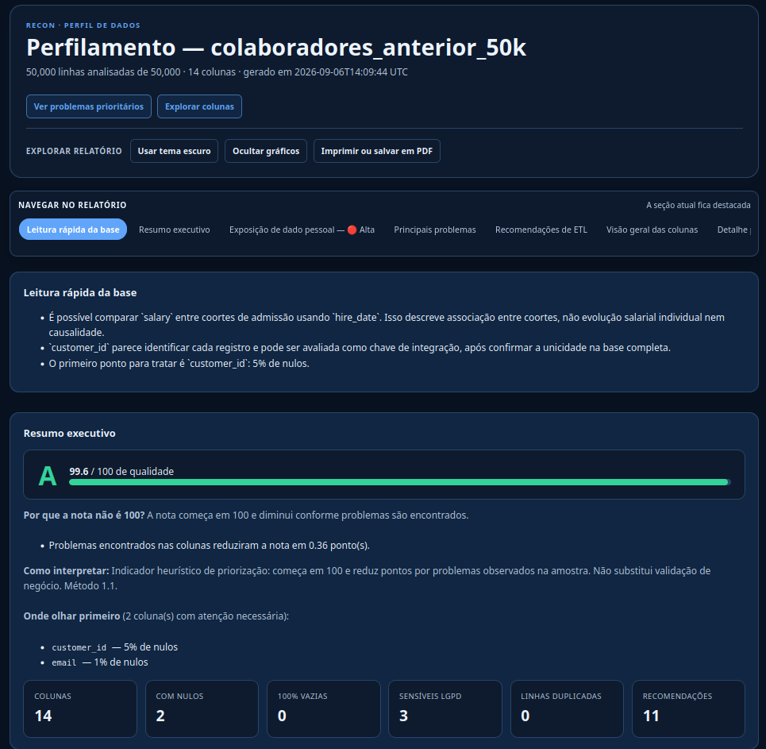

<div align="center">

# Recon

**Local data profiling and data quality, with Brazilian data in mind.**<br>
Find out what is inside a CSV, Excel, JSON or Parquet file before you analyze it: real types, nulls, personal data (LGPD/GDPR-style), keys and relationships between tables.

[](https://github.com/Caio-Analytics/recon-data-profiler/actions/workflows/ci.yml)
[](LICENSE)
[](pyproject.toml)
[](CONTRIBUTING.md)

[Português](README.md) · [Quick start](#quick-start) · [Contributing](#contributing)



</div>

> **Language note.** The interface, the reports and most of the documentation are in
> Brazilian Portuguese. This page is a short English introduction so you can decide
> whether the project is useful to you and how to contribute. Translating the rest is
> an open item in the [backlog](docs/BACKLOG.md) (REP-2 and DOC-3).

## What it is

You received a spreadsheet and you do not know what is in it. Recon reads the file, infers structure, quality, personal data, the meaning of each column and the relationships between tables, and produces a report you open in your browser. It also has a desktop window, so no terminal is needed.

**Your data stays on your machine.** Recon does not send anything to external services and does not need the internet to analyze.

## Why Recon

- **Understands Brazilian data.** Validates CPF and CNPJ, parses day-first dates and `1.234,56` numbers, and detects personal data as defined by Brazil's LGPD.
- **Private by default.** 100% local. Personal values are masked in reports, and the generated cleanup script pseudonymizes with HMAC.
- **More than a column profile.** Finds keys, fact and dimension tables, functional dependencies and business rules (for example an end date earlier than its start date).
- **Tracks change.** Compares two extractions, shows quality over time, and freezes a reference as a YAML data contract.
- **Gives you the next step.** ETL recommendations and a cleanup script in pandas, SQL or Power Query (M).
- **For programmers and non-programmers.** Command line, Python API and a graphical interface.

Outputs: an interactive HTML report (main output), JSON, Markdown, PDF and an XLSX data dictionary.

## Quick start

Requires Python 3.12 or newer.

```bash
git clone https://github.com/Caio-Analytics/recon-data-profiler.git
cd recon-data-profiler
python -m venv .venv
source .venv/bin/activate          # Windows: .venv\Scripts\activate
python -m pip install -e ".[gui]"

recon perfilar data.csv            # profile one table (report in the same folder)
recon janela                       # or open the graphical window
python examples/gerar_demo.py      # try it on synthetic data (writes Output/demo/)
```

As a library:

```python
import pandas as pd
from recon import DataProfiler

report = DataProfiler().processar_dataframe(pd.read_csv("data.csv"), "data")
print(report["metadados_execucao"]["score_qualidade"]["nota"])
```

The command names are in Portuguese (`perfilar` = profile, `lote` = batch, `modelar` = model relationships, `conferir` = compare versions, `historico` = history, `contrato` = contract). `recon --help` lists everything.

> There is no `pip install` package or downloadable executable yet. Both are in the [backlog](docs/BACKLOG.md#10-distribuição-e-instalação) and are good first contributions.

## Contributing

Contributions are welcome, and not only code. People who know **statistics**, **Brazilian data formats**, **accessibility** or **technical writing** have places to help: the [backlog](docs/BACKLOG.md) groups items by the kind of knowledge they need.

1. Pick a [`good first issue`](https://github.com/Caio-Analytics/recon-data-profiler/labels/good%20first%20issue) or a backlog item.
2. Read [CONTRIBUTING.md](CONTRIBUTING.md) (in Portuguese) and comment on the issue that you are working on it. Issues and pull requests in English are welcome.
3. Open a pull request. CI runs lint, type checking, tests and a dependency audit.

Questions go to [Discussions](https://github.com/Caio-Analytics/recon-data-profiler/discussions). Security issues: see [SECURITY.md](SECURITY.md) and do not open a public issue.

## License

[MIT](LICENSE). You may use, modify and redistribute Recon, including commercially, keeping the copyright notice and license.
