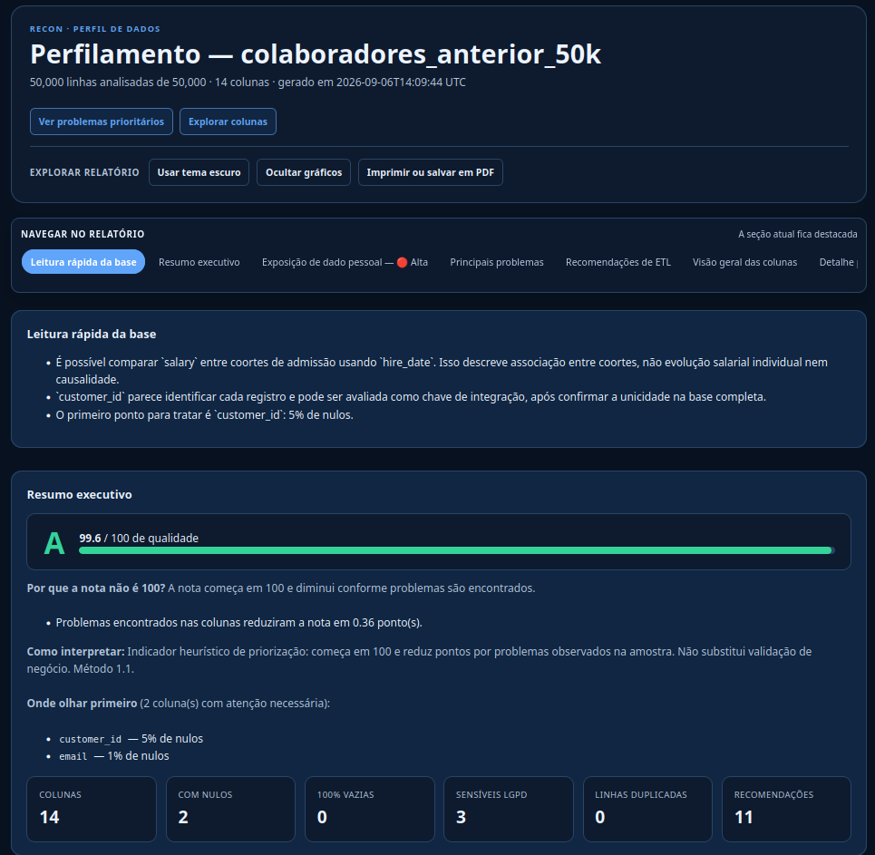
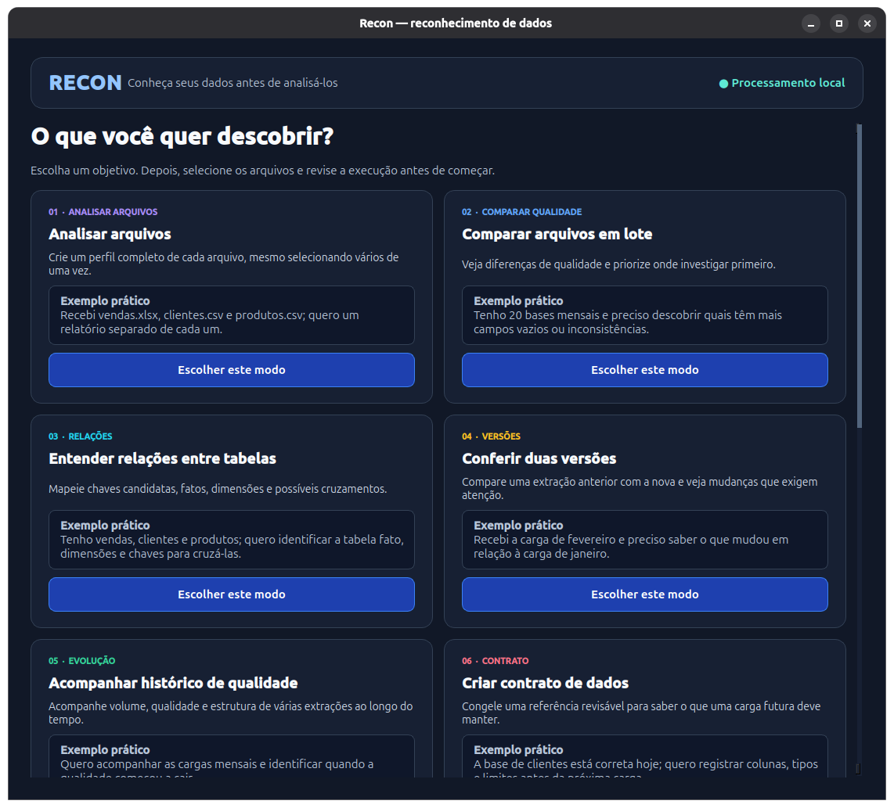

<div align="center">

# Recon

**Perfilamento e qualidade de dados, local e em português.**<br>
Descubra o que há em um CSV, Excel, JSON ou Parquet antes de analisar: tipos reais, nulos, dados pessoais (LGPD), chaves e relações entre tabelas.

[](https://github.com/Caio-Analytics/recon-data-profiler/actions/workflows/ci.yml)
[](LICENSE)
[](pyproject.toml)
[](CONTRIBUTING.md)

[Começar](#começar-em-poucos-minutos) · [Guia de uso](docs/GUIA.md) · [Contribuir](CONTRIBUTING.md) · [Backlog](docs/BACKLOG.md) · [English](README.en.md)



</div>

## O que é

Você recebeu uma planilha e não sabe o que tem dentro. O Recon lê o arquivo, identifica estrutura, qualidade, possíveis dados pessoais, o significado de cada coluna e as relações entre tabelas, e gera um relatório que você abre no navegador. Também funciona por janela, sem terminal.

**Os dados ficam na sua máquina.** O Recon não envia nada para serviços externos e não precisa de internet para analisar.

## Por que usar o Recon

| | |
|---|---|
| 🇧🇷 **Entende dados brasileiros** | Valida CPF e CNPJ, lê datas com o dia primeiro, reconhece números no formato `1.234,56` e detecta dado pessoal conforme a LGPD |
| 🔒 **Privacidade por padrão** | 100% local. Valores pessoais saem mascarados nos relatórios e o script de limpeza pseudonimiza com HMAC |
| 🧭 **Vai além do perfil de colunas** | Aponta chaves, tabelas fato e dimensão, dependências entre colunas e regras de negócio (ex.: data de fim antes da data de início) |
| 🔁 **Acompanha mudanças** | Compara duas extrações, mostra a evolução da qualidade ao longo do tempo e congela uma referência em um contrato de dados YAML |
| 🧹 **Entrega o próximo passo** | Gera recomendações de ETL e um script de limpeza em pandas, SQL ou Power Query (M) |
| 🖥️ **Para quem programa e para quem não** | Linha de comando, API em Python e interface gráfica |

O relatório HTML é a saída principal. Há também JSON (para integrar), Markdown, PDF e dicionário de dados em XLSX.

<div align="center">

</div>

## Escolha o que precisa fazer

| Se você quer... | Use |
|---|---|
| Entender um arquivo que acabou de receber | `recon perfilar dados.csv` |
| Comparar várias bases ou extrações | `recon lote janeiro.csv fevereiro.csv` |
| Descobrir como tabelas se relacionam | `recon modelar vendas.csv clientes.csv` |
| Conferir o que mudou entre duas versões | `recon conferir antes.csv depois.csv` |
| Acompanhar a qualidade de extrações recorrentes | `recon historico jan.csv fev.csv mar.csv` |
| Criar ou validar uma referência de qualidade | `recon contrato` e `recon validar` |

Em uma análise, o Recon mostra tipo real, nulos, unicidade, distribuição e exemplos protegidos quando há dado pessoal. Também aponta riscos de qualidade, recomendações de ETL, relações candidatas entre tabelas e mudanças entre extrações.

## Começar em poucos minutos

Requer Python 3.12 ou superior.

```bash
git clone https://github.com/Caio-Analytics/recon-data-profiler.git
cd recon-data-profiler
python -m venv .venv
source .venv/bin/activate          # Windows: .venv\Scripts\activate
python -m pip install -e ".[gui]"
```

Abra a interface gráfica:

```bash
recon janela
```

Ou gere um relatório pelo terminal:

```bash
recon perfilar dados.csv
```

Abra o arquivo HTML gerado no navegador. Para ver o resultado sem usar dados reais, gere a demonstração:

```bash
python examples/gerar_demo.py      # o resultado fica em Output/demo/
```

> Ainda não há instalação por `pip install` nem executável para baixar. Os dois estão no [backlog](docs/BACKLOG.md#10-distribuição-e-instalação) e são bons candidatos a contribuição.

## Todos os comandos

```bash
recon perfilar dados.csv                 # perfil de uma tabela
recon lote janeiro.csv fevereiro.csv     # compara arquivos em lote
recon modelar vendas.csv clientes.csv    # relações entre tabelas
recon conferir antes.csv depois.csv      # mudança entre duas extrações
recon historico jan.csv fev.csv mar.csv  # evolução longitudinal
recon contrato dados.csv                 # cria contrato YAML editável
recon validar dados_novos.csv --contrato contrato.yaml
recon dicionario vendas.csv clientes.csv # gera dicionário XLSX
recon revisar-semantica dados.csv        # cria YAML para revisar classificações
recon pasta ./extracoes --modo auto      # analisa todos os arquivos de uma pasta
recon fonte sqlite:///dados.db --sql "SELECT * FROM vendas"   # SQLite ou DuckDB local
```

Use `recon --help` para ver todas as opções da versão instalada. Para usar como biblioteca:

```python
import pandas as pd
from recon import DataProfiler

relatorio = DataProfiler().processar_dataframe(pd.read_csv("dados.csv"), "dados")
print(relatorio["metadados_execucao"]["score_qualidade"]["nota"])
```

## Privacidade e arquivos grandes

O Recon usa até 70% da RAM disponível. Se uma leitura integral exceder esse orçamento, usa amostragem e registra a cobertura e as limitações no relatório. Em amostras, confirme chaves, duplicatas e categorias raras na base completa.

Relatórios podem conter metadados corporativos. Valores classificados como pessoais são mascarados, mas os resultados devem continuar sendo tratados como documentos internos. O script de limpeza usa pseudonimização com HMAC e exige a variável de ambiente `RECON_PSEUDONYMIZATION_KEY`. Guarde essa chave fora do script e dos relatórios; pseudonimizar não é o mesmo que anonimizar.

## Documentação

| Documento | Para quê |
|---|---|
| [Guia de uso](docs/GUIA.md) | Instalação, interface gráfica e exemplos passo a passo |
| [Documentação técnica](docs/TECNICO.md) | Arquitetura, formato do JSON, critérios de cada análise e pontos de extensão |
| [Backlog](docs/BACKLOG.md) | O que pode melhorar, organizado por área e por conhecimento exigido |
| [Histórico de mudanças](CHANGELOG.md) | O que mudou em cada versão |
| [Contribuição](CONTRIBUTING.md) | Como preparar o ambiente, alterar e validar o projeto |
| [Código de conduta](CODE_OF_CONDUCT.md) | Como esperamos que as pessoas interajam no projeto |
| [Segurança e privacidade](SECURITY.md) | Como tratar dados e relatar vulnerabilidades |

## Contribuindo

Contribuições são bem-vindas, e não só de código. Quem entende de **estatística**, de **dados brasileiros**, de **acessibilidade** ou de **documentação** também tem onde ajudar: o [backlog](docs/BACKLOG.md) separa os itens pelo tipo de conhecimento exigido.

1. Escolha uma issue marcada como [`good first issue`](https://github.com/Caio-Analytics/recon-data-profiler/labels/good%20first%20issue) ou um item do backlog.
2. Leia o [guia de contribuição](CONTRIBUTING.md) e comente na issue que vai trabalhar nela.
3. Abra o pull request. A CI roda lint, tipagem, testes e auditoria de dependências.

Dúvidas de uso vão para as [Discussions](https://github.com/Caio-Analytics/recon-data-profiler/discussions). Para preparar o ambiente de desenvolvimento:

```bash
python -m pip install -r requirements-dev.lock
python -m pip install -e . --no-deps
pytest -q
```

## Citar o projeto

Se usar o Recon em um trabalho, use o botão **Cite this repository** do GitHub, que lê o arquivo [CITATION.cff](CITATION.cff).

## Licença

Distribuído sob a [licença MIT](LICENSE). Você pode usar, modificar e redistribuir o Recon, inclusive para fins comerciais, mantendo o aviso de copyright e a licença.
